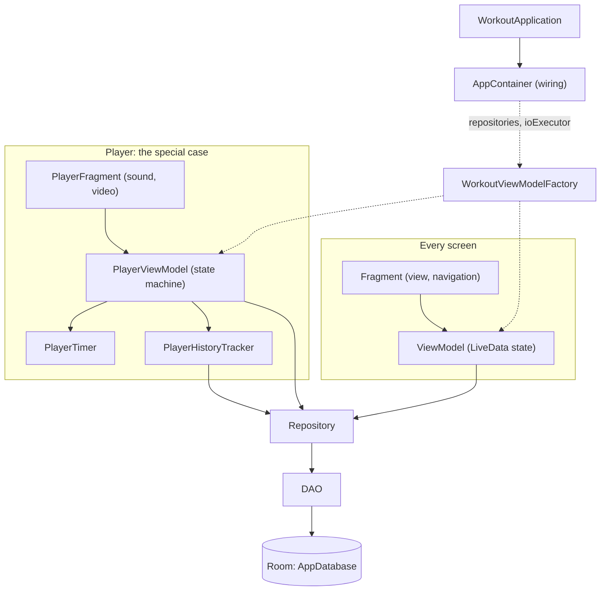

# Workout

[](https://github.com/bettinawoste-wq/Workout/actions/workflows/ci.yml)

Workout is an Android app for building your own workouts from your own exercises, running
them with a timer and audio cues, and looking back at what you actually did. It is made for
people who train at home with bodyweight exercises and want a plain, focused tool instead of
a fitness platform. Everything stays on the phone in a Room database: no account, no backend,
no tracking, and nothing to lose when a service shuts down. The interface is in German.

| Home | Workout editor | Player | History |
| :---: | :---: | :---: | :---: |
|  |  |  |  |

## Features

- **Exercises** — title, description and an optional photo or video; photos are framed in the
  editor without touching the original file, and exercises without one show a placeholder image.
- **Workouts** — a named, ordered list of exercises with a duration each, reordered by drag and
  drop, saved as you edit, duplicable, and shown with a thumbnail of every exercise.
- **Player** — countdowns into and out of every exercise, a soft start tone, a darkened preview
  of the next exercise, a progress bar, skip and back, and a chime with a summary at the end.
- **History** — every workout session, completed or aborted, with planned vs. actual duration
  per exercise; it survives deleting the workout it was recorded against.
- **Starter set** — a fresh install comes with 10 bodyweight exercises and a full-body workout,
  which afterwards are ordinary data you can edit or delete.
- **Design** — Material 3 with a petrol palette, following the system's light or dark mode.

## Architecture

Every screen follows the same MVVM layering; the player is the one screen with real logic of
its own. [`CONTEXT.md`](CONTEXT.md) describes it in detail.



- **`AppContainer`** is a hand-written dependency container, built once in `WorkoutApplication`;
  `WorkoutViewModelFactory` hands it to every ViewModel
  ([ADR 0001](docs/adr/0001-manual-di-container.md)).
- **Fragments** render state and navigate; **ViewModels** hold the screen state as `LiveData`
  and do all database work off the main thread.
- **Repositories** wrap the **DAOs**; **Room** stores everything, with explicit, tested
  migrations between schema versions ([ADR 0004](docs/adr/0004-exported-room-schemas.md)).
- **The player** keeps its state machine in `PlayerViewModel`, counts time in `PlayerTimer`
  and writes the workout session and its exercise sessions through `PlayerHistoryTracker`.

## Development approach

This app was built by its owner together with [Claude Code](https://claude.com/claude-code),
with a clear split of roles.

**The owner** brings the product idea and the requirements, makes the decisions in grillings,
keeps the domain model ([`GLOSSARY.md`](GLOSSARY.md) and the [ADRs](docs/adr/)), cuts the
issues, reviews and accepts every pull request, tests on the device, and cuts the releases.

**Claude Code** implements test-first from those issues and reviews the code as a second check.

Every change runs through the same workflow:

1. **Idea** — something the app should do, or do better.
2. **Grilling** — the idea is questioned until the requirements and the domain terms are
   settled; lasting decisions become an ADR.
3. **Issue** — the result is cut into a GitHub issue with acceptance criteria.
4. **TDD** — Claude Code implements it red → green against the issue.
5. **Review** — the change is reviewed against the coding standards and the issue.
6. **PR** — the owner tests it on the device, then accepts and merges the pull request.

Examples from this repo:

- Framing exercise photos: [ADR 0003](docs/adr/0003-non-destructive-framing.md) →
  [issue #31](https://github.com/bettinawoste-wq/Workout/issues/31) →
  [PR #36](https://github.com/bettinawoste-wq/Workout/pull/36).
- A workout editor without a save button:
  [issue #45](https://github.com/bettinawoste-wq/Workout/issues/45) →
  [PR #49](https://github.com/bettinawoste-wq/Workout/pull/49).
- The MVVM migration: [issue #1](https://github.com/bettinawoste-wq/Workout/issues/1) as the
  map, [issue #2](https://github.com/bettinawoste-wq/Workout/issues/2) and
  [ADR 0001](docs/adr/0001-manual-di-container.md) for the wiring, and one issue per screen,
  e.g. [issue #13](https://github.com/bettinawoste-wq/Workout/issues/13) →
  [PR #16](https://github.com/bettinawoste-wq/Workout/pull/16) for the player's tests.

## Tech stack

- Java, Android Gradle Plugin, min SDK 24 / target SDK 37
- Room (SQLite) for persistence, with explicit versioned migrations
- Media3 (ExoPlayer) for video playback
- View Binding, ViewModel + LiveData; a small manual DI container instead of a framework
  (see [`docs/adr/0001-manual-di-container.md`](docs/adr/0001-manual-di-container.md))

## Building

```bash
./gradlew assembleDebug
```

Install to a connected device/emulator:

```bash
./gradlew installDebug
```

Run the unit tests, and the instrumented tests on a connected device or emulator:

```bash
./gradlew testDebugUnitTest
python scripts/device-test.py
```

`device-test.py` installs over the existing debug app and keeps its data, unlike
`./gradlew connectedDebugAndroidTest`, which uninstalls it afterwards.
`python scripts/readme-screenshots.py` renews the screenshots above from a release build.

Signed release APKs are attached to each [GitHub Release](https://github.com/bettinawoste-wq/Workout/releases); how they are built
is described in [`docs/releasing.md`](docs/releasing.md).

## Project docs

- [`CONTEXT.md`](CONTEXT.md) — domain model and current architecture
- [`docs/releasing.md`](docs/releasing.md) — signing key setup and how to cut a release
- [`GLOSSARY.md`](GLOSSARY.md) — the domain language used in code and issues
- [`docs/adr/`](docs/adr/) — architecture decision records
- [`docs/sounds.md`](docs/sounds.md) — where the app's sounds come from
- [`docs/agents/`](docs/agents/) — conventions for AI coding agents working in this repo

## License

This project is licensed under the MIT License; see [`LICENSE`](LICENSE).
