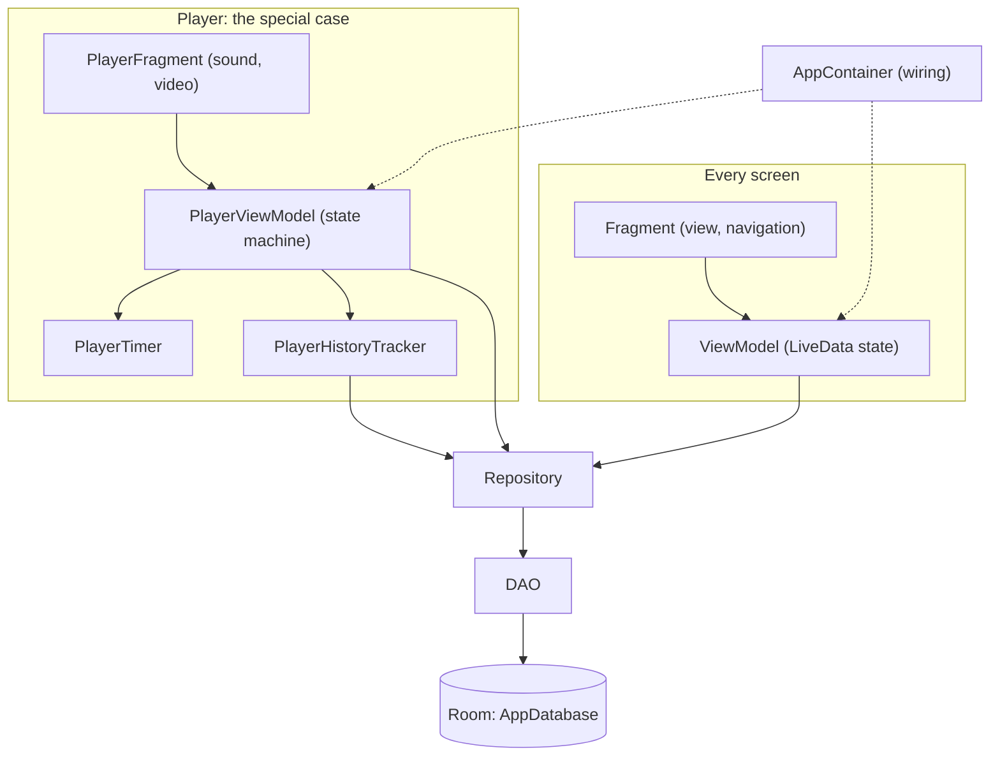

# Workout

[](https://github.com/bettinawoste-wq/Workout/actions/workflows/ci.yml)

Workout is an Android app for building your own workouts from your own exercises, running
them with a timer and audio cues, and looking back at what you actually did. It is made for
people who train at home with bodyweight exercises and want a plain, focused tool instead of
a fitness platform. Everything stays on the phone in a Room database: no account, no backend,
no tracking, and nothing to lose when a service shuts down. The interface is in German.

| Home | Workout editor | Player | History |
| :---: | :---: | :---: | :---: |
|  |  |  |  |

## Features

- **Exercises** — title, description and an optional photo or video; a photo is framed by zooming
  with two fingers and moving with one, the file untouched; without a picture, a placeholder image.
- **Workouts** — a named, ordered list of exercises with a duration each, reordered by drag and
  drop, saved as you edit, duplicable, and shown with a thumbnail of every exercise.
- **Player** — countdowns, a soft start tone, a quiet transition, the coming exercise darkened, skip and
  back; a bar of exercise time left in the workout; a chime and a summary of total time and skipped exercises.
- **History** — every workout session, completed or aborted, with planned vs. actual duration per
  exercise; browse and delete sessions, which survive deleting the workout they were recorded against.
- **Starter set** — a fresh install comes with 10 bodyweight exercises and a full-body workout at one
  minute per exercise; afterwards they are ordinary data you can edit or delete.
- **Design** — Material 3 with a petrol palette, following the system's light or dark mode.

## Architecture

Every screen follows the same MVVM layering; the player is the screen with the most logic of its own.



- ViewModels touch the database only off the main thread.
- Migrations are tested from version 4, the oldest schema any release shipped
  ([ADR 0004](docs/adr/0004-exported-room-schemas.md)).

[`CONTEXT.md`](CONTEXT.md) describes the architecture in detail.

## Development approach

This app was built by its owner together with [Claude Code](https://claude.com/claude-code),
with a clear split of roles.

**The owner** brings the product idea and the requirements, makes the decisions in grillings,
keeps the domain model ([`GLOSSARY.md`](GLOSSARY.md) and the [ADRs](docs/adr/)), cuts the
issues, reviews and accepts every change before it lands, tests on the device, and cuts the releases.

**Claude Code** implements test-first from those issues and reviews the code as a second check.

The workflow:

1. **Idea** — something the app should do, or do better.
2. **Grilling** — questions until the requirements and domain terms are settled; a lasting
   decision becomes an ADR.
3. **Issue** — the outcome, with acceptance criteria.
4. **TDD** — red → green against those criteria.
5. **Review** — Claude Code's code review as a second check, then the owner's review.
6. **Land** — pushed straight to `master` once accepted, keeping the history linear; CI runs on
   every push.

Until November 2026, changes landed through pull requests, so the examples below link them.

The full flow, on framing exercise photos: the grilling's decision became
[ADR 0003](docs/adr/0003-non-destructive-framing.md), then
[issue #31](https://github.com/bettinawoste-wq/Workout/issues/31), then
[PR #36](https://github.com/bettinawoste-wq/Workout/pull/36).

More from this repo:

- Issue to PR, for a workout editor without a save button:
  [issue #45](https://github.com/bettinawoste-wq/Workout/issues/45) →
  [PR #49](https://github.com/bettinawoste-wq/Workout/pull/49).
- The MVVM migration: [issue #1](https://github.com/bettinawoste-wq/Workout/issues/1) as the
  map, [issue #2](https://github.com/bettinawoste-wq/Workout/issues/2) for the wiring, and one
  issue per screen, such as [issue #4](https://github.com/bettinawoste-wq/Workout/issues/4) for
  the player, built in commits straight on `master`.

## Tech stack

- Java, Android Gradle Plugin, min SDK 24 / target SDK 37
- Room (SQLite) for persistence, with explicit versioned migrations
- Media3 (ExoPlayer) for video playback
- View Binding, ViewModel + LiveData; a small manual DI container instead of a framework
  (see [`docs/adr/0001-manual-di-container.md`](docs/adr/0001-manual-di-container.md))

## Building

```bash
./gradlew assembleDebug
```

Install to a connected device/emulator:

```bash
./gradlew installDebug
```

Run the unit tests, and the instrumented tests on a connected device or emulator:

```bash
./gradlew testDebugUnitTest
python scripts/device-test.py
```

`device-test.py` installs over the existing debug app and keeps its data, unlike
`./gradlew connectedDebugAndroidTest`, which uninstalls it afterwards.
`python scripts/readme-screenshots.py` renews the screenshots above from a release build.

Signed release APKs are attached to each [GitHub Release](https://github.com/bettinawoste-wq/Workout/releases); how they are built
is described in [`docs/releasing.md`](docs/releasing.md).

## Project docs

- [`CONTEXT.md`](CONTEXT.md) — domain model and current architecture
- [`docs/releasing.md`](docs/releasing.md) — signing key setup and how to cut a release
- [`GLOSSARY.md`](GLOSSARY.md) — the domain language used in code and issues
- [`docs/adr/`](docs/adr/) — architecture decision records
- [`docs/sounds.md`](docs/sounds.md) — where the app's sounds come from
- [`docs/agents/`](docs/agents/) — conventions for AI coding agents working in this repo

## License

This project is licensed under the MIT License; see [`LICENSE`](LICENSE).
