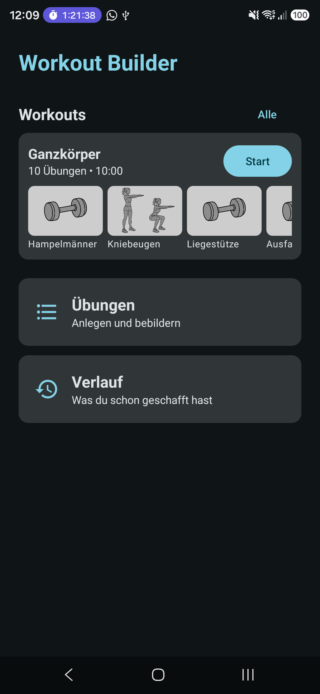
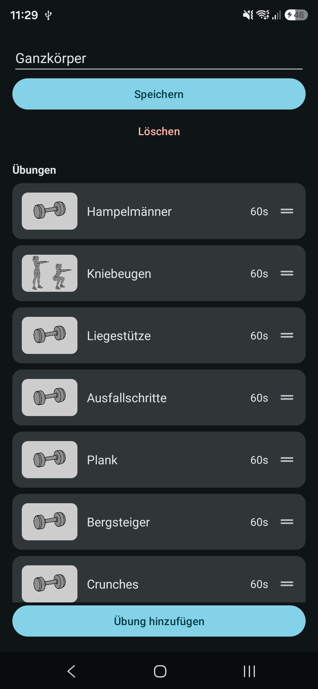
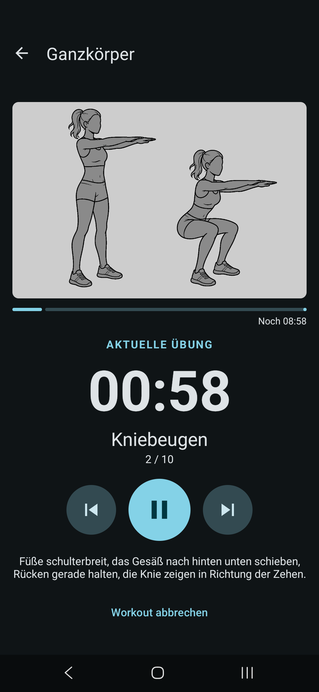
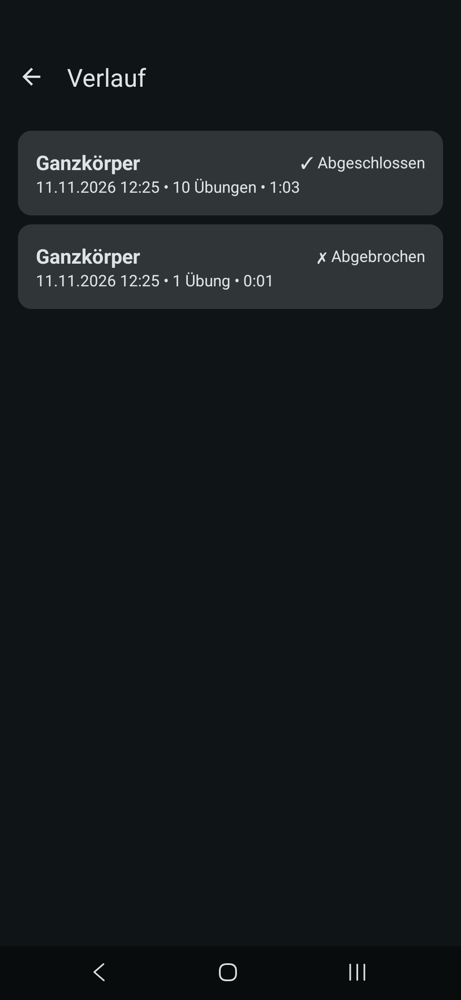

# Workout

A local-only Android app for building custom workouts, running them with a timer and
audio cues, and reviewing past sessions afterward. Everything is stored on-device in
Room — no account, no backend.

| Home | Workout editor | Player | History |
| :---: | :---: | :---: | :---: |
|  |  |  |  |

## Features

- **Exercises** — create/edit exercises with a photo or video demo (orientation-correct
  thumbnails, looping video preview).
- **Workouts** — build a named, ordered list of exercises with a duration each; reorder
  by drag-and-drop.
- **Player** — runs through a workout with a countdown timer, audio start/end cues, and
  a confirmation dialog before cancelling.
- **History** — every run is recorded (completed or aborted, with per-exercise actual vs.
  planned duration), browsable and deletable independently of whether the source workout
  still exists.
- **Starter set** — a fresh install comes with 10 bodyweight exercises and a ready-made
  full-body workout (one minute per exercise); afterwards they're ordinary data you can
  edit or delete.

## Tech stack

- Java, Android Gradle Plugin, min SDK 24 / target SDK 37
- Room (SQLite) for persistence, with explicit versioned migrations
- Media3 (ExoPlayer) for video playback
- View Binding + Data Binding
- Incremental migration to ViewModel + LiveData (see [`CONTEXT.md`](CONTEXT.md) for how far that's progressed)

## Building

```bash
./gradlew assembleDebug
```

Install to a connected device/emulator:

```bash
./gradlew installDebug
```

Run the unit and instrumented test suites:

```bash
./gradlew testDebugUnitTest
./gradlew connectedDebugAndroidTest   # needs a connected device/emulator
```

Signed release APKs are attached to each [GitHub Release](https://github.com/bettinawoste-wq/Workout/releases); how they are built
is described in [`docs/releasing.md`](docs/releasing.md).

## Project docs

- [`CONTEXT.md`](CONTEXT.md) — domain model and current architecture
- [`docs/releasing.md`](docs/releasing.md) — signing key setup and how to cut a release
- [`docs/adr/`](docs/adr/) — architecture decision records
- [`docs/agents/`](docs/agents/) — conventions for AI coding agents working in this repo
